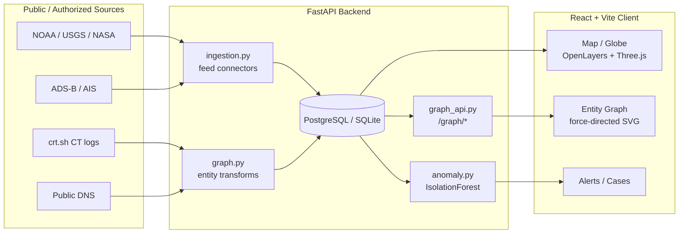
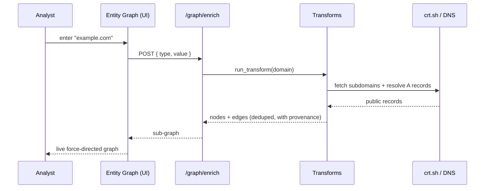

<div align="center">

# 🛰️ RTAIP

### Real-Time Analysis & Intelligence Platform

**An open-source OSINT + open-geo intelligence fusion platform.**
A live situational-awareness map fused with an entity-correlation graph — the "see everything" experience, built **only on public and authorized data**.

<br/>

[](https://rtaip.vercel.app)
[](LICENSE)
[](docs/ETHICS.md)


</div>

---

## 🔭 What is RTAIP?

RTAIP ingests **open intelligence feeds** and **public OSINT sources**, correlates
them into an **entity graph**, and renders everything on a **real-time
geospatial map / globe** with anomaly detection and alerting. It is designed to
*feel* like a global all-seeing dashboard while remaining strictly ethical and
legal: **no private-individual tracking, no surveillance, no unauthorized
access** — see the [Responsible-Use Policy](docs/ETHICS.md).

> **Two linked brains:** a **map** streaming open geo-feeds (quakes, weather,
> disasters, flights, vessels) and an **entity graph** where you pivot across
> public footprints (domains → subdomains → IPs). Click an entity, see it in
> context; expand it, watch the network grow.

---

## ✨ Features

| | Capability | Status |
|---|---|---|
| 🧠 | **Entity-correlation graph** — nodes/edges, click-to-expand OSINT pivots | ✅ |
| 🌍 | **Geospatial fusion** — NOAA, USGS, NASA EONET, ADS-B, AIS on a live map/globe | ✅ |
| 🔌 | **Connector registry** — pluggable, enable/disable public feeds | ✅ |
| 🚨 | **Anomaly detection** — IsolationForest + rule-based + geofenced alerts | ✅ |
| 🗂️ | **Cases & workspaces** — multi-tenant orgs, audit & consent logs | ✅ |
| 🔎 | **OSINT transforms** — Certificate Transparency (crt.sh), public DNS | ✅ |
| 🧾 | **Provenance** — every datapoint carries source, timestamp, confidence | ✅ |
| 🛰️ | Vessel/aircraft live layers, GDELT events, pgvector entity resolution | 🚧 |

---

## 🧩 Architecture





---

## 🔌 Connectors

**Geospatial (open feeds):** `noaa_alerts` · `usgs_quakes` · `nasa_eonet` · `adsb_aircraft` · `ais_maritime` · `reddit_keywords`

**OSINT transforms (keyless, public):** `crt.sh` (Certificate Transparency → subdomains) · `dns.google` (DoH A-record resolution → IPs)

> Adding a connector? Follow [CONTRIBUTING.md](CONTRIBUTING.md) — document the
> source, its license/ToS, and rate limits. OSINT-targeting-individuals
> connectors are rejected by policy.

---

## 🚀 Quickstart

**Backend**
```bash
cd backend
python -m venv .venv && source .venv/bin/activate   # Windows: .venv\Scripts\activate
pip install -r requirements.txt
uvicorn main:app --reload --port 8000
```

**Frontend**
```bash
cd frontend-vite
npm install
echo "VITE_BACKEND_URL=http://localhost:8000" > .env.local
npm run dev     # http://localhost:5173  → open /graph
```

---

## 🛰️ Graph API

| Method | Endpoint | Purpose |
|---|---|---|
| `GET`  | `/graph/full?limit=400` | Load recent entities + edges |
| `GET`  | `/graph/pivot/{id}` | 1-hop neighborhood (click-to-expand) |
| `POST` | `/graph/enrich` | Run an OSINT transform on a seed (`{type,value}`) |
| `GET`  | `/graph/stats` | Entity/relationship counts by type |

---

## 🗺️ Roadmap

- [x] Entity-graph schema + correlation engine
- [x] crt.sh + public-DNS OSINT transforms
- [x] Force-directed graph UI with pivots
- [ ] Map ⟷ graph cross-linking (click entity → pin on map)
- [ ] More OSINT connectors (Shodan, HIBP, WHOIS, OpenCorporates)
- [ ] Real-time push (Supabase Realtime) + watchlists
- [ ] Postgres + PostGIS + pgvector for scale & entity resolution
- [ ] SaaS hardening (RLS, billing, rate-limit, audit export)

📋 Track progress on the [**Project board**](https://github.com/kamikaze1120/RTAIP/projects).

---

## 🤝 Contributing & Community

- [Contributing Guide](CONTRIBUTING.md)
- [Code of Conduct](CODE_OF_CONDUCT.md)
- [Security Policy](SECURITY.md)
- [Responsible-Use / Ethics](docs/ETHICS.md)

## 🧱 Tech Stack


---

## ⭐ Star History

[](https://star-history.com/#kamikaze1120/RTAIP&Date)

---

<div align="center">

**RTAIP** · Built by [@kamikaze1120](https://github.com/kamikaze1120) · Licensed under [MIT](LICENSE)
<br/>
<sub>Open intelligence, responsibly. Public data only.</sub>

</div>
