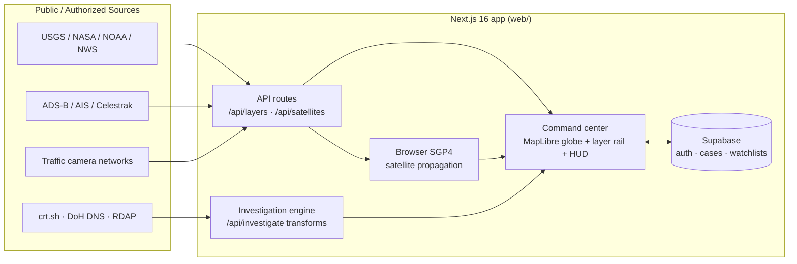

<div align="center">

# 🛰️ RTAIP

### Real-Time Analysis & Intelligence Platform

**An open-source OSINT + open-geo intelligence fusion platform.**
A full-screen live command center — a situational-awareness globe fused with an
entity-correlation graph — the "see everything" experience, built **only on
public and authorized data**.

<br/>

[](https://rtaip.vercel.app)
[](LICENSE)
[](docs/ETHICS.md)


</div>

---

## 🔭 What is RTAIP?

RTAIP ingests **open intelligence feeds** and **public OSINT sources**, renders
them on a **real-time geospatial globe**, and lets you **pivot any domain, IP or
email into an entity graph** — all inside one full-screen command center. It is
designed to *feel* like a global all-seeing dashboard while staying strictly
ethical and legal: **no private-individual tracking, no surveillance, no
unauthorized access** — see the [Responsible-Use Policy](docs/ETHICS.md).

> **Two linked brains:** a **command center globe** streaming dozens of open
> geo-feeds (quakes, weather, disasters, flights, vessels, satellites, cameras)
> and an **investigation engine** where you pivot across public footprints
> (domains → subdomains → IPs → orgs). Draw an area, watch it for alerts, pin
> findings, and share a live view by URL.

The production app is the **Next.js 16 command center in [`web/`](web/)**. The
legacy FastAPI + Vite prototype remains in `backend/` and `frontend-vite/` for
reference.

---

## ✨ Features

| | Capability | Status |
|---|---|---|
| 🌍 | **Command center globe** — 3D globe / 2D map / satellite / night-lights, place search, draw-an-area, shareable view links, keyboard shortcuts | ✅ |
| 📡 | **Live map layers** — 15+ keyless public feeds (see below), refreshed on their own schedules | ✅ |
| 🛰️ | **In-browser satellites** — TLEs propagated client-side (stations, GPS, Galileo, BeiDou, Starlink, weather, science) with orbit tracks | ✅ |
| 📷 | **Public traffic cameras** — London, New York, California, Singapore, New Zealand, Finland (1,000+ live cameras, clustered) | ✅ |
| 🔎 | **Investigation engine** — pivot a domain / IP / email: DNS, RDAP/WHOIS, Certificate Transparency, IP geolocation, streamed as transforms resolve | ✅ |
| 🧾 | **Provenance** — every datapoint carries source, timestamp and confidence | ✅ |
| 🚨 | **Geofence alerts** — draw a region, get notified on emergency squawks, quakes and events inside it | ✅ |
| 🗂️ | **Cases & watchlists** — save entities, annotate, and track over time | ✅ |
| 🧠 | Exposure risk scoring, graph UX (path-finding, grouping), alert delivery, AI analyst | 🚧 |

---

## 📡 Live map layers

All layers use **public, keyless** sources and are proxied through serverless API
routes with per-source caching and rate limiting.

| Group | Layers | Source |
|---|---|---|
| **Air** | Civil aircraft · Military aircraft (emergency-squawk highlight) | Community ADS-B |
| **Sea** | Ships (AIS) · Ports & chokepoints | Digitraffic AIS · reference data |
| **Space** | Satellites (in-browser SGP4) · Aurora · Day/night terminator | Celestrak · NOAA SWPC |
| **Earth** | Earthquakes · Natural events · Fires · Weather alerts · Rain radar | USGS · NASA EONET/GDACS · NASA FIRMS · US NWS · RainViewer |
| **Cyber** | Botnet C2 servers | abuse.ch Feodo Tracker |
| **Geopolitics** | Conflict zones (curated, not a live measurement) | RTAIP editorial list |
| **Cameras** | Traffic cameras — London · New York · California · Singapore · New Zealand · Finland | TfL · NYC DOT · Caltrans · LTA Singapore · NZTA (Waka Kotahi) · Fintraffic/Digitraffic |

---

## 🔎 Investigation transforms

Keyless, public, and run server-side with timeouts and caching:

`dns` (DoH A/NS/MX resolution) · `rdap` / WHOIS (registration + ASN) ·
`certs` (crt.sh Certificate Transparency → subdomains) ·
`ipgeo` (IP geolocation & network)

> Adding a layer or transform? Follow [CONTRIBUTING.md](CONTRIBUTING.md) —
> document the source, its license/ToS and rate limits. Connectors that target
> private individuals are rejected by policy.

---

## 🧩 Architecture



---

## 🚀 Quickstart

The app lives in **`web/`** (Next.js 16, Turbopack, TypeScript, Tailwind v4).

```bash
cd web
npm install
npm run dev        # http://localhost:3000
```

Useful scripts:

```bash
npm run build      # production build
npm run typecheck  # tsc --noEmit
npm run lint       # eslint
npm test           # vitest
```

No API keys are required for the live map layers or the OSINT transforms.
Supabase env vars are only needed for sign-in, cases and watchlists.

---

## 🗺️ Roadmap

RTAIP is tracked as a phased program (E0 – E11) on the GitHub project board.

- [x] **E0 – Stabilize** — honest health, real error/empty states, locked-down routes
- [x] **Command center** — full-screen globe, live layers, satellites, cameras, area tools, shareable views
- [x] **Investigation engine** — streaming domain/IP/email transforms with provenance
- [ ] **E3/E4 – Transforms & graph UX** — org transforms (OpenCorporates, OpenSanctions, GDELT), WebGL graph with path-finding
- [ ] **E5/E6 – Fusion & alerts** — map⟷graph cross-linking, watchlists, realtime push
- [ ] **E7/E8 – Cases & AI analyst** — annotations, PDF/STIX export, retrieval with citations
- [ ] **E9–E11 – Design system, quality, launch**

📋 Track progress on the [**issues**](https://github.com/kamikaze1120/RTAIP/issues) and project board.

---

## 🤝 Contributing & Community

- [Contributing Guide](CONTRIBUTING.md)
- [Code of Conduct](CODE_OF_CONDUCT.md)
- [Security Policy](SECURITY.md)
- [Responsible-Use / Ethics](docs/ETHICS.md)

## 🧱 Tech Stack


---

## ⭐ Star History

[](https://star-history.com/#kamikaze1120/RTAIP&Date)

---

<div align="center">

**RTAIP** · Built by [@kamikaze1120](https://github.com/kamikaze1120) · Licensed under [MIT](LICENSE)
<br/>
<sub>Open intelligence, responsibly. Public data only.</sub>

</div>
