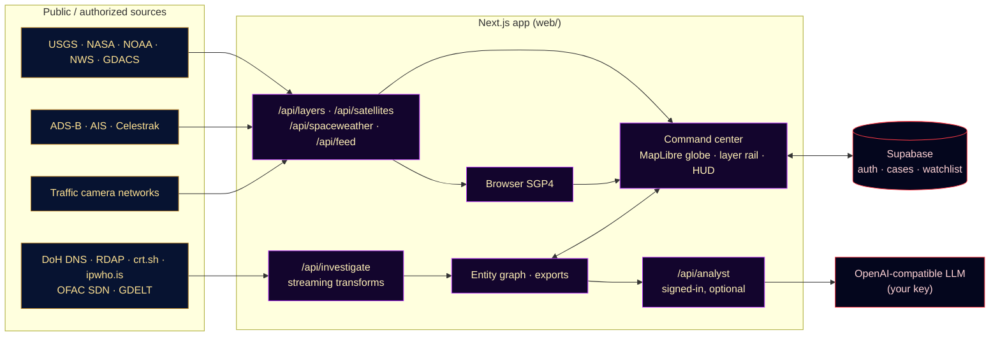

<p align="center">
  
</p>

<p align="center">
  
</p>

<p align="center">
  <a href="https://rtaip.vercel.app"></a>
</p>

<p align="center">
  
  
  <a href="LICENSE"></a>
  <a href="https://github.com/kamikaze1120/RTAIP/actions/workflows/ci.yml"></a>
</p>

**RTAIP** (Real-Time Analysis & Intelligence Platform) is an open-source OSINT and open-geo workspace. A full-screen command center puts live public feeds on a MapLibre globe, and an investigation engine turns a domain, IP address, email or organization name into an entity graph in which every node records where it came from. It runs only on public or explicitly authorized data.

<p align="center"><sub><code>OSINT</code> ✦ <code>OPEN GEO</code> ✦ <code>SGP4</code> ✦ <code>ENTITY GRAPH</code> ✦ <code>STIX 2.1</code> ✦ <code>PROVENANCE</code></sub></p>

<h2 align="center">✦ WHAT IT DOES ✦</h2>
<p align="center"><sub>THE COMMAND CENTER AND THE INVESTIGATION ENGINE</sub></p>

<table>
  <tr>
    <td width="33%" valign="top">🌍 <b>Command center globe</b><br><sub>3D globe, 2D map, satellite and night-lights base modes (<code>G</code> <code>M</code> <code>S</code> <code>N</code>), place search, a layer rail, a HUD with space weather, and shareable view links.</sub></td>
    <td width="33%" valign="top">📡 <b>Keyless live layers</b><br><sub>Aircraft, ships, quakes, fires, natural events, weather alerts, rain radar, aurora, botnet C2s and more. Each one is proxied, cached and rate-limited server-side.</sub></td>
    <td width="33%" valign="top">🛰️ <b>Satellites in the browser</b><br><sub>Celestrak element sets are propagated client-side with <code>satellite.js</code> (SGP4): stations, Starlink, Galileo, BeiDou, GEO, science and more.</sub></td>
  </tr>
  <tr>
    <td valign="top">📷 <b>Public traffic cameras</b><br><sub>Keyless DOT and 511 feeds across US states plus London, Singapore, Hong Kong, New Zealand and Finland. Optional worldwide webcams with a Windy key.</sub></td>
    <td valign="top">🔎 <b>Investigation engine</b><br><sub>Seed a domain, IP, email or company name. DNS, RDAP, certificate transparency, IP geolocation, OFAC sanctions and GDELT news results stream in as NDJSON.</sub></td>
    <td valign="top">🧾 <b>Provenance and risk</b><br><sub>Every entity carries its source, fetch time and confidence. Findings roll up into a 0–100 exposure score (low, guarded, elevated or high).</sub></td>
  </tr>
  <tr>
    <td valign="top">🧷 <b>Entity graph</b><br><sub>A d3-force graph with node details, re-pivoting, type filters, shortest-path highlighting, group-by-type clustering and links between the graph and the map.</sub></td>
    <td valign="top">📤 <b>Exports</b><br><sub>Markdown report, CSV, JSON, a <b>STIX 2.1</b> bundle and a <b>PDF</b> report (jsPDF), all generated in the browser.</sub></td>
    <td valign="top">🤖 <b>AI analyst (optional)</b><br><sub>Writes a cited brief from the current investigation using any OpenAI-compatible endpoint. Only signed-in users can use it, and it stays off until you set a key.</sub></td>
  </tr>
  <tr>
    <td valign="top">🚨 <b>Area alerts</b><br><sub>Draw an area to get alerts on aircraft emergency squawks (7500/7600/7700), military aircraft, quakes and events inside it.</sub></td>
    <td valign="top">🗂️ <b>Cases and watchlists</b><br><sub>Save investigations as cases and re-score watched entities over time. Backed by Supabase and requires sign-in.</sub></td>
    <td valign="top">🩺 <b>Source health</b><br><sub>The <code>/sources</code> page shows the live status of every upstream feed the app depends on.</sub></td>
  </tr>
</table>

<h2 align="center">◈ RESPONSIBLE USE ◈</h2>
<p align="center"><sub>A HARD PRODUCT BOUNDARY</sub></p>

> [!IMPORTANT]
> RTAIP gives you a "see everything" view of the **world**. It does not watch **people**.
>
> - **Public or authorized data only.** Open geospatial feeds, public DNS and registries, certificate transparency, public threat-intel lists, and assets you own or are explicitly authorized to assess.
> - **Provenance on everything.** Every record carries a source, a timestamp and a confidence, so any conclusion can be traced back to its evidence.
> - **It will not** track or geolocate specific private individuals, run facial or voice recognition, access cameras, phones, accounts or devices without authorization, or deanonymize, dox, stalk or harass anyone.
> - Emails are used only to reach their domain. Private, local and reserved IP ranges are refused. Connectors that target private individuals are rejected in review.
>
> Full policy: [docs/ETHICS.md](docs/ETHICS.md) · Report misuse: [SECURITY.md](SECURITY.md)

<h2 align="center">◆ LIVE MAP LAYERS ◆</h2>
<p align="center"><sub>KEYLESS, PUBLIC, REFRESHED ON THEIR OWN SCHEDULES</sub></p>

| Group | Layers | Source |
|---|---|---|
| 🛩️ **Air** | Civil aircraft (loads for the visible area) · Military aircraft | Community ADS-B (OpenSky optional fallback) |
| 🚢 **Sea** | Ships (Baltic and Nordic AIS) · Ports and chokepoints | Digitraffic AIS · reference data |
| 🛰️ **Space** | Satellites (in-browser SGP4) · Aurora · Day/night terminator | Celestrak · NOAA SWPC |
| 🌋 **Earth** | Earthquakes · Natural events · Fires (24h) · Weather alerts · Rain radar | USGS · NASA EONET + GDACS · NASA FIRMS · US NWS · RainViewer |
| 🛡️ **Cyber** | Botnet C2 servers | abuse.ch Feodo Tracker |
| 🗺️ **Geopolitics** | Conflict zones (a curated list, not a live measurement) | RTAIP editorial list |
| 📷 **Cameras** | NYC, Seattle/WSDOT, Caltrans, VDOT, and the FL, GA, PA, AZ, NV, WI, ID, LA, CT, AK and New England 511 sites · London · Singapore · Hong Kong · New Zealand · Finland · optional worldwide | NYC DOT · WSDOT · Caltrans · VDOT · state 511 (Castle Rock "CARS") · TfL · LTA · HK Transport Dept · NZTA · Fintraffic · Windy Webcams *(key)* |

<details>
<summary><b>🔎 Investigation transforms</b> (click to expand)</summary>

<br>

All transforms are keyless, run server-side with timeouts and caching, and attach provenance to everything they emit.

| Transform | Accepts | What it adds |
|---|---|---|
| `email` | email | The email's domain (no person or breach lookups) |
| `dns` | domain, subdomain, nameserver, mailserver | DNS-over-HTTPS A / NS / MX resolution |
| `rdap` | domain | Registration and network data (RDAP/WHOIS) |
| `certs` | domain | Subdomains from certificate transparency (crt.sh) |
| `ipgeo` | ip | IP geolocation and network |
| `sanctions` | org | Screening against the US OFAC SDN list |
| `gdelt` | org, domain | Recent open-source news mentions |

</details>

<h2 align="center">✦ ARCHITECTURE ✦</h2>
<p align="center"><sub>ONE NEXT.JS APP: SERVERLESS PROXIES, A BROWSER GLOBE AND SUPABASE</sub></p>



<h2 align="center">◈ TECH STACK ◈</h2>
<p align="center"><sub>WHAT THE LIVE APP IS BUILT ON</sub></p>

<p align="center">
  
</p>

<p align="center"><sub>Next.js 16 · React 19 · TypeScript · Tailwind v4 · MapLibre GL · satellite.js · d3-force · jsPDF · Zod · Supabase · Vitest</sub></p>

<h2 align="center">◆ QUICK START ◆</h2>
<p align="center"><sub>THE APP LIVES IN <code>web/</code></sub></p>

```bash
git clone https://github.com/kamikaze1120/RTAIP.git
cd RTAIP/web
cp .env.example .env.local   # every value is optional
npm install
npm run dev                  # http://localhost:3000
```

| Script | Does |
|---|---|
| `npm run dev` | Next.js dev server (syncs the MapLibre worker first) |
| `npm run build` / `npm start` | Production build and serve |
| `npm run typecheck` | `tsc --noEmit` |
| `npm run lint` | ESLint |
| `npm test` | Vitest unit tests (layers, transforms, graph paths, STIX, PDF, geofence, SGP4…) |

The map layers and OSINT transforms need **no API keys**. Supabase is needed only for sign-in, cases and watchlists.

<details>
<summary><b>⚙️ Environment variables</b> (names only)</summary>

<br>

| Variable | Scope | Purpose |
|---|---|---|
| `NEXT_PUBLIC_SUPABASE_URL` | browser | Supabase project URL (auth, cases, watchlist) |
| `NEXT_PUBLIC_SUPABASE_ANON_KEY` | browser | Supabase anon key |
| `NEXT_PUBLIC_MAP_STYLE_URL` | browser | Optional basemap style (defaults to a free dark style) |
| `OPENSKY_USERNAME` / `OPENSKY_PASSWORD` | server | Optional OpenSky fallback for aircraft |
| `WINDY_WEBCAMS_API_KEY` | server | Optional worldwide webcams (Central/South Asia, Middle East, Africa, South America) |
| `LLM_BASE_URL` / `LLM_API_KEY` | server | Turns on the AI analyst (any OpenAI-compatible `/chat/completions`) |
| `LLM_MODEL` | server | Optional model override for the analyst |

The analyst route requires a signed-in user, is rate-limited, and returns `503` until both `LLM_*` values are set. It only summarizes evidence already in the investigation and cites its sources.

</details>

<details>
<summary><b>🗂️ Project structure</b></summary>

<br>

```text
RTAIP/
├── web/                        # ★ the live app (Next.js)
│   └── src/
│       ├── app/                # pages: / (command center), /map, /investigate,
│       │   │                   #        /cases, /watchlist, /sources, /auth/callback
│       │   └── api/            # analyst · feed · health · investigate ·
│       │                       # layers/[layer] · satellites · spaceweather
│       ├── components/         # GraphCanvas, InvestigateView, CommandPalette…
│       │   └── command/        # CommandCenter, LayerRail, Hud, Dock, Ticker
│       └── lib/
│           ├── layers/         # one module per map layer
│           ├── transforms/     # dns, rdap, certs, ipgeo, email, sanctions, gdelt
│           ├── supabase/       # browser + server clients
│           └── *.ts            # satEngine, stix, pdf, geofence, graphPath, analyst…
├── backend/                    # legacy FastAPI prototype (not the live app)
├── frontend-vite/              # legacy Vite prototype (not the live app)
└── docs/                       # ETHICS.md, DEPLOY.md
```

> `backend/` and `frontend-vite/` are an earlier FastAPI + Vite prototype, kept for reference. The current CI workflow still builds those two directories. The product is `web/`.

</details>

<h2 align="center">✦ ROADMAP ✦</h2>
<p align="center"><sub>TRACKED ON THE ISSUES AND PROJECT BOARD</sub></p>

- [x] Command center: globe, live layers, satellites, cameras, area tools, shareable views
- [x] Investigation engine: streaming transforms with provenance, OFAC + GDELT, risk score
- [x] Graph UX: detail panel, re-pivot, filters, path-finding, group-by-type, graph ⟷ map
- [x] Exports: Markdown, CSV, JSON, STIX 2.1, PDF
- [x] AI analyst: cited brief, bring your own OpenAI-compatible LLM
- [ ] More organization transforms (OpenCorporates, OpenSanctions)
- [ ] Realtime push for watchlists, and case annotations with cited retrieval
- [ ] Design system, quality pass, launch

<h2 align="center">◈ CONTRIBUTING ◈</h2>
<p align="center"><sub>NEW LAYERS AND TRANSFORMS ARE WELCOME</sub></p>

Read [CONTRIBUTING.md](CONTRIBUTING.md) first. Every new source must document its license or terms of service and its rate limits, and it must pass the [responsible-use policy](docs/ETHICS.md). Community: [Code of Conduct](CODE_OF_CONDUCT.md) · [Security](SECURITY.md) · [Deploy notes](docs/DEPLOY.md).

<h2 align="center">◆ LICENSE ◆</h2>

<p align="center">MIT — see <a href="LICENSE">LICENSE</a>.</p>

<p align="center">
  <sub><code>◉ OPEN INTELLIGENCE, RESPONSIBLY // GILDED ORBIT</code></sub><br>
  <sub>Built by <a href="https://github.com/kamikaze1120">@kamikaze1120</a></sub>
</p>
